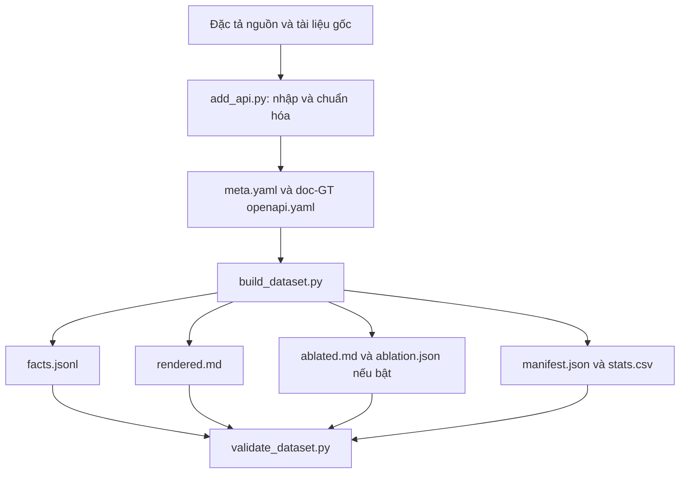
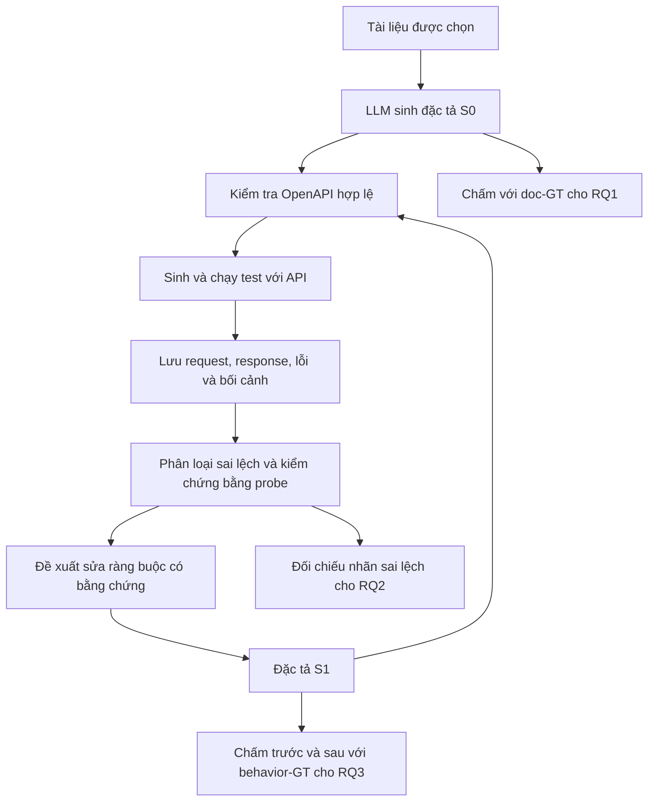

# Review SpecLoop-Bench v0.1

Ngày review: 28/10/2026. Phạm vi: dữ liệu của cả 9 API, metadata, đặc tả nguồn và đặc tả chuẩn hóa, facts, tài liệu render/ablation, công cụ Python, Bookstore-Lab và cấu hình Docker.

## 1. Kết luận

SpecLoop-Bench là bộ dữ liệu thực nghiệm cho bài toán sinh đặc tả OpenAPI từ tài liệu và cải thiện đặc tả bằng phản hồi kiểm thử. Bộ này đã có dữ liệu và công cụ hỗ trợ; chưa có hệ thống LLM hay chương trình tự chạy toàn bộ vòng phản hồi.

Phần có giá trị nhất là Bookstore-Lab: có tài liệu viết tay, API chạy được, đáp án theo tài liệu, đáp án theo hành vi, 13 sai lệch có chủ đích và 10 đối chứng. Phần còn lại mở rộng quy mô và lĩnh vực, nhưng chưa có ground truth hành vi được xác minh.

Có thể dùng ngay cho nghiên cứu thăm dò sau khi hiểu phạm vi chấm điểm. Trước khi dùng làm benchmark chính để kết luận RQ1–RQ3, cần sửa bộ trích xuất/chấm điểm, xác minh môi trường chạy và chốt giao thức thực nghiệm.

## 2. Những gì đã kiểm tra thực tế

| Kiểm tra | Kết quả |
|---|---|
| Tệp được manifest liệt kê | 63/63 tồn tại, SHA-256 đều khớp |
| Validator có sẵn | Cả 9 API đạt; vẫn có cảnh báo thiếu tài liệu gốc/chưa kiểm tra kết nối |
| Facts lưu sẵn so với trích xuất lại | Cả 9 API khớp toàn bộ bản ghi theo key và nội dung |
| Tài liệu rendered so với render lại trong bộ nhớ | Cả 9 API khớp |
| Tài liệu ablated và các khóa được ẩn | Cả 3 API có ablation khớp; mọi hidden key đều được renderer xử lý |
| Đặc tả nguồn → chuẩn hóa lại, áp dụng servers hiện tại | Cả 8 API nhập từ nguồn ngoài khớp đặc tả đang lưu |
| Test hành vi Bookstore-Lab | 20/20 đạt; 1 cảnh báo deprecation từ thư viện TestClient |
| Doc-GT Bookstore chấm với behavior-GT, bỏ type | Constraint F1 = 0,8116; micro F1 = 0,8612 |

Các phép thử thay đổi đặc tả bên dưới chạy trên bản sao trong bộ nhớ hoặc thư mục tạm; không sửa dữ liệu chuẩn. Đã cài các thư viện cần cho validator và pytest vào `.venv`. Không chạy lại Schemathesis, không dựng Docker và không gọi API công khai trong lần review này. Hai tệp Schemathesis trong `sut/sanity/` là kết quả có sẵn, không phải kết quả vừa chạy.

## 3. Đơn vị dữ liệu và quy mô

Một mẫu cấp cao là một API, gồm tài liệu đầu vào, đáp án để đối chiếu và thông tin môi trường kiểm thử. Một operation là cặp phương thức HTTP và đường dẫn, ví dụ `GET /books`. Một atomic fact là một thông tin nhỏ được tách ra từ đặc tả, ví dụ `limit.maximum = 100`.

| API | Operation | Facts | Tài liệu gốc độc lập trong folder | Trạng thái thực tế theo dữ liệu cục bộ |
|---|---:|---:|---|---|
| bookstore-lab | 8 | 285 | Có, viết tay | Có mã API, Dockerfile, doc-GT và behavior-GT; test hành vi đạt |
| fdic | 6 | 3.977 | Chưa có | Có spec và bản render; kết nối và behavior-GT chưa xác minh |
| genome-nexus | 23 | 3.984 | Chưa có | Có spec và bản render; kết nối và behavior-GT chưa xác minh |
| language-tool | 2 | 39 | Chưa có | Có spec và bản render; cần chú ý body dạng form và phạm vi read-only |
| ohsome | 122 | 11.642 | Chưa có | API lớn nhất; tài liệu render khoảng 73.476 từ; cần phân đoạn |
| omdb | 1 | 112 | Chưa có | Metadata yêu cầu `OMDB_API_KEY`; chưa xác minh runtime |
| petstore3 | 19 | 521 | Chưa có | Có dịch vụ Docker dùng image `unstable`; behavior-GT chưa xác minh |
| realworld-conduit | 19 | 924 | Có, bản lưu tài liệu | Chưa kèm backend tham chiếu chạy sẵn; behavior-GT chưa xác minh |
| rest-countries | 21 | 166 | Chưa có | Được cấu hình offline, chỉ RQ1; không có response-field facts |
| Tổng | 221 | 21.650 | 2/9 API | Chỉ 1/9 API có behavior-GT |

Số facts không phải số ví dụ huấn luyện độc lập. Một schema dùng ở nhiều operation sẽ tạo nhiều facts. ohsome chiếm khoảng 55,2% operation và 53,8% facts; gộp mọi API vào một điểm sẽ khiến API này ảnh hưởng rất lớn.

Trong 11.772 constraint facts có 8.295 facts `type`. Bỏ `type` còn 3.477 facts: 800 ở đầu vào/operation và 2.677 ở phản hồi. Vì vậy, nếu mục tiêu chính là sửa ràng buộc đầu vào, cần báo cáo riêng phần đó.

## 4. Vai trò từng loại tệp

| Tệp/thư mục | Vai trò | Được đưa cho hệ thống đang đánh giá? |
|---|---|---|
| `source/openapi_original.*` | Lưu bản đặc tả nguồn trước chuẩn hóa | Không, nếu bài toán là sinh spec từ tài liệu |
| `docs/original.*` | Tài liệu viết cho người đọc, nếu có | Có, ở nhánh dùng tài liệu gốc |
| `docs/rendered.md` | Tài liệu sinh tự động từ doc-GT | Có, ở nhánh dùng tài liệu render |
| `docs/ablated.md` | Bản render đã bỏ một số ràng buộc được chọn | Có, ở nhánh đánh giá tài liệu thiếu thông tin |
| `ground_truth/openapi.yaml` | Đáp án theo tài liệu, gọi là doc-GT | Chỉ bộ chấm và người quản lý thí nghiệm |
| `ground_truth/facts.jsonl` | Các facts trích xuất từ doc-GT | Chỉ bộ chấm |
| `ground_truth/behavior_openapi.yaml` | Đáp án theo hành vi đã xác minh, hiện có ở Bookstore | Chỉ bộ chấm |
| `ground_truth/behavior_facts.jsonl` | Facts theo behavior-GT | Chỉ bộ chấm |
| `ground_truth/ablation.json` | Danh sách ràng buộc bị ẩn và seed chọn | Chỉ bộ chấm/người dựng thí nghiệm |
| `ground_truth/discrepancies.*` | Đáp án sai lệch, probe tái hiện, đối chứng | Không đưa cho bộ phát hiện/sửa trong lúc đánh giá |
| `meta.yaml` | Nguồn, môi trường, auth, scope và trạng thái xác minh | Chỉ cấp các trường vận hành cần thiết cho runner |
| `sut/` | System Under Test: mã API đang được kiểm thử | API được chạy; không cho LLM đọc mã khi đánh giá black-box |
| `manifest.json`, `stats.csv` | Thống kê và nhận diện phiên bản dữ liệu | Dùng quản lý thực nghiệm |

Nếu cấp cả folder cho một coding agent đọc tự do, agent có thể đọc GT hoặc danh sách sai lệch. Khi đó kết quả không còn phản ánh đúng bài toán tài liệu → đặc tả. Cần giới hạn đầu vào rõ ràng, không chỉ nhắc bằng prompt.

## 5. Hai quy trình khác nhau

### 5.1. Quy trình dựng dataset đã được cài đặt



1. `add_api.py` lưu spec nguồn, chuẩn hóa về 3.0.3, có thể lưu tài liệu gốc, tạo metadata rồi gọi build và validate. Một số trường ban đầu là TODO và cần người nhập hoàn thiện.
2. `build_dataset.py` dùng GT để sinh facts, render tài liệu, tạo biến thể ablation và cập nhật thống kê/hash. Đây là công cụ dựng dữ liệu; nó không gọi LLM.
3. Ablation lấy khoảng 40% trong tập ràng buộc đầu vào đủ điều kiện dò bằng probe, không phải 40% toàn bộ facts. Seed dựa trên ID API, nên cùng dữ liệu/công cụ sẽ chọn lại được cùng tập.
4. `validate_dataset.py` kiểm tra cấu trúc và một phần tính nhất quán. Chữ ĐẠT không có nghĩa mọi hành vi API đã đúng hoặc mọi cảnh báo đã được giải quyết.
5. Riêng `sut/make_discrepancies.py` tạo `discrepancies.json` từ YAML nguồn và chênh lệch giữa hai GT. `build_dataset.py` không tự gọi bước này.

### 5.2. Quy trình thực nghiệm cần xây thêm



Folder hiện chưa có chương trình gọi mô hình, prompt chuẩn, bộ phân đoạn tài liệu, bộ phân loại lỗi, bộ áp dụng patch hay bộ điều phối vòng lặp. `evaluate.py` chỉ chấm đặc tả so với GT; chưa chấm trực tiếp danh sách sai lệch mà hệ thống phát hiện được.

## 6. Hiểu hai đáp án chuẩn bằng ví dụ

### Ví dụ A: tài liệu thiếu giới hạn `limit`

Tài liệu và doc-GT chỉ nói `limit` là số nguyên, mặc định 20. API thật chỉ nhận từ 1 đến 100.

```text
Tài liệu → S0: limit là integer, default 20
Test: GET /v1/books?limit=101
Phản hồi: 400, "limit must be between 1 and 100"
Probe xác nhận: 0 bị từ chối; 1 và 100 được nhận; 101 bị từ chối
S1: thêm minimum: 1, maximum: 100
```

S0 có thể đúng hoàn toàn theo tài liệu nhưng chưa mô tả đủ hành vi. S1 tốt hơn theo behavior-GT, nhưng hai ràng buộc mới có thể bị chấm là thừa nếu vẫn dùng doc-GT. Vì vậy phải chọn GT theo câu hỏi nghiên cứu.

### Ví dụ B: tài liệu quá chặt với `price`

Tài liệu yêu cầu `price > 0`; API chấp nhận `price = 0`. Trong S1, giữ `minimum: 0` và bỏ `exclusiveMinimum: true`. Chỉ thêm ràng buộc mà không cho phép sửa/bỏ ràng buộc sẽ không xử lý được trường hợp này.

### Ví dụ C: lỗi máy chủ không nên được “hợp thức hóa”

`GET /authors?page=-1` gây 500 có chủ đích. Dataset coi đây là lỗi cài đặt D0; behavior-GT vẫn giữ `page.minimum = 1`. Hệ thống cần nhận diện lỗi máy chủ và giữ ràng buộc, thay vì đổi spec để cho phép page âm hoặc coi thêm response 500 là đã sửa xong vấn đề.

Behavior-GT trong bộ này vì vậy là đáp án hành vi mục tiêu trong phạm vi đã xác minh, có ngoại lệ chính sách đối với lỗi cài đặt; không phải bản ghi mọi hành vi quan sát được của server.

## 7. Bộ chấm điểm đang làm gì?

`extract_facts.py` tách spec thành 7 nhóm: endpoint, parameter, request_body, request_field, response, response_field và constraint. Một constraint có dạng:

```json
{"category":"constraint","op":"GET /v1/books","location":"query:limit","name":"limit","keyword":"maximum","value":100}
```

`evaluate.py` so sánh các khóa. Với constraint, giá trị cũng phải trùng. Nếu đoán `maximum: 50` trong khi GT là 100 thì tính một FP và một FN. Precision phản ánh phần dự đoán đúng, recall phản ánh phần GT tìm được, F1 cân bằng hai tỷ lệ.

`--no-type` bỏ keyword `type` khỏi nhóm constraint; các nhóm endpoint, field, response… vẫn được tính. Đây không phải chế độ chỉ chấm ràng buộc. Xem riêng `by_category.constraint` nếu cần constraint F1.

Phép đo tham chiếu đã tái hiện: lấy chính doc-GT Bookstore làm dự đoán và chấm với behavior-GT, bỏ `type`, cho constraint F1 0,8116 và micro F1 0,8612. Đây là khoảng cách giữa hai GT, không phải kết quả của một LLM đã chạy và cũng không phải mức trần cho hệ thống có thêm thông tin.

## 8. Phát hiện cần xử lý, theo mức ưu tiên

### P1 — Mất 48/64 điều kiện phụ thuộc của ohsome khi trích xuất

Vị trí: `tools/extract_facts.py:55` và `:169`.

Mỗi dependency trong cùng operation được đưa vào cùng một key. `FactSink.add()` giữ bản ghi đầu tiên và bỏ các bản ghi tiếp theo. Trong ohsome có 64 điều kiện khai báo trên 16 operation, nhưng facts chỉ giữ 16 điều kiện.

Ví dụ `GET /elements/area/ratio` có 4 điều kiện:

```text
OnlyOne(bboxes, bcircles, bpolys);
ZeroOrOne(filter, Or(types, keys, values));
IF values THEN keys;
IF values2 THEN keys2;
```

Chỉ điều kiện đầu đi vào facts. Hệ thống bỏ 3 điều kiện sau vẫn không bị phạt ở phần điểm này. Cần thiết kế định danh cho từng dependency, quy tắc so khớp biểu thức, rồi dựng lại facts, thống kê và manifest.

### P1 — F1 = 1 không bảo đảm đặc tả đúng hoặc đầy đủ

Vị trí: `tools/extract_facts.py:116`, `:142`; `tools/evaluate.py:98`.

Đã tái hiện trên dữ liệu thật:

| Thay đổi trên bản sao spec | Điểm hiện tại | Ý nghĩa |
|---|---:|---|
| BookCreate.tags.items.type: string → integer | micro F1 = 1,0000 | Không chấm kiểu phần tử mảng primitive này |
| Xóa security và securitySchemes khỏi Petstore | micro F1 = 1,0000 | Không chấm xác thực |
| Xóa toàn bộ info khỏi Bookstore | micro F1 = 1,0000 | Prediction không hợp lệ vẫn có thể được chấm tuyệt đối |

Các giới hạn khác thấy từ mã: chỉ dùng media type đầu tiên; giới hạn độ sâu; không chấm đủ schema ở root; không bao phủ đầy đủ headers, additionalProperties và cấu trúc logic schema. `oneOf`/`anyOf` bị duyệt thành tập field, có thể mất ý nghĩa từng nhánh. Không nên mô tả điểm hiện tại là độ đúng toàn bộ OpenAPI.

Cần tách tỷ lệ spec hợp lệ khỏi điểm nội dung; bổ sung coverage theo mục tiêu nghiên cứu; công bố rõ thành phần chưa chấm. Với cấu trúc phức tạp, không nên chỉ thêm keyword mà bỏ qua ngữ nghĩa.

### P1 — Chưa đủ dữ liệu hành vi để kết luận RQ2–RQ3 trên cả 9 API

Vị trí: `apis/*/meta.yaml`; `docker-compose.sut.yml:12`.

Chỉ Bookstore có behavior-GT. Petstore/Conduit và toàn bộ API nhóm B vẫn pending. Conduit chưa có backend tham chiếu được chọn và đưa vào Compose. Các API công khai chưa được metadata đánh dấu kiểm tra kết nối. REST Countries đang offline theo cấu hình.

`rq_scope: [RQ1, RQ2, RQ3]` thể hiện dự định sử dụng; chưa chứng minh đã đủ điều kiện đánh giá. Nên chỉ công bố RQ2–RQ3 định lượng trên phần có nhãn và bằng chứng xác minh, phần còn lại báo cáo riêng như ca nghiên cứu thăm dò.

### P2 — Validator chưa kiểm tra đầy đủ giá trị facts và không fail khi hash lệch

Vị trí: `tools/validate_dataset.py:78` và `:112`.

Validator so tập key của facts, không so giá trị. Trong bản sao tạm, đổi một `minimum` thành 999999 vẫn không sinh lỗi nhất quán facts khi gọi `check_api` không kèm danh sách hash. Khi chạy đầy đủ với manifest cũ, hash của tệp đã đổi sẽ tạo cảnh báo, nhưng vẫn không được tính là lỗi và tiến trình vẫn có thể báo ĐẠT.

Dữ liệu hiện tại không bị lỗi này: kiểm tra độc lập đã xác nhận facts lưu sẵn khớp toàn bộ nội dung trích xuất lại. Cần sửa validator để so bản ghi/giá trị, kiểm tra behavior facts và discrepancy diff, kiểm tra đủ thành viên manifest theo hai chiều, và có chế độ strict cho bản phát hành.

### P2 — Nhãn exact của Bookstore cần giới hạn phạm vi và mở rộng kiểm chứng

Vị trí: `apis/bookstore-lab/sut/app.py:190`; `apis/bookstore-lab/meta.yaml:34`.

20 test có sẵn xác nhận được các tình huống đã viết, không chứng minh mọi hành vi đều khớp GT. Đã thử thêm `published_at`:

| Giá trị gửi | Phản hồi POST /books | Giá trị lưu/trả lại |
|---|---:|---|
| 2024-05-01 | 201 | 2024-05-01 |
| 20240501 | 201 | 20240501 |
| 2024-W18-3 | 201 | 2024-W18-3 |

Tài liệu yêu cầu `YYYY-MM-DD`, nhưng `date.fromisoformat()` chấp nhận thêm các dạng trên và API giữ nguyên chuỗi. Đây là hành vi ngoài danh sách sai lệch có chủ đích hiện tại. Cần quyết định siết định dạng theo tài liệu hay bổ sung nhãn sai lệch để tránh chấm phát hiện đúng thành cảnh báo sai.

13 sai lệch hiện phủ 8 mã: D0, D1, D2, D4, D5, D7, D8, D9; chưa có mẫu D3 và D6. Một sai lệch mức người đọc có thể tạo nhiều fact diff; không được đồng nhất 13 sai lệch với 13 facts.

### P2 — Đổi tên biến path tương đương vẫn bị trừ điểm tham số

Vị trí: `tools/oas_utils.py:213`; `tools/extract_facts.py:149`.

Đổi `/books/{book_id}` thành `/books/{id}` và đổi tên path parameter tương ứng: endpoint F1 vẫn 1,0 nhưng parameter F1 giảm còn 0,9 trên Bookstore; micro F1 giảm còn 0,9860. Endpoint đã chuẩn hóa tên biến, nhưng parameter/constraint key vẫn chứa tên gốc. Nếu mong muốn chấm tương đương ngữ nghĩa, cần chuẩn hóa tham số path theo vị trí.

### P2 — Tài liệu render và ablation cần được diễn giải đúng

Vị trí: `tools/render_docs.py`; `apis/bookstore-lab/docs/ablated.md:53`; `apis/petstore3/docs/ablated.md:79`.

7/9 API chỉ có tài liệu render từ GT. Đây là bài toán dựng lại spec từ biểu diễn văn bản có cấu trúc của chính nó; không đại diện đầy đủ cho tài liệu viết tay thiếu nhất quán. Cần báo cáo riêng rendered/original/ablated.

Ablation ẩn theo operation và vị trí, không ẩn mọi lần xuất hiện của cùng thông tin. Ví dụ enum `genre` ở request tạo sách bị ẩn nhưng ba giá trị vẫn xuất hiện ở response trong cùng tài liệu. Petstore ẩn enum request `status` nhưng các giá trị còn trong response và operation khác. Điều này cho phép suy ra từ tài liệu còn lại; không thể mặc định mọi ràng buộc được khôi phục đều đến từ phản hồi runtime.

Nếu muốn đo đóng góp riêng của feedback, cần baseline cùng tài liệu không có feedback, kiểm tra dấu vết thông tin còn lại, và cân nhắc ẩn theo nhóm schema/ràng buộc. Lưu ý enum genre trong doc-GT cũng khác behavior-GT: mục tiêu khôi phục tài liệu và mục tiêu sửa đúng hành vi phải được chấm riêng.

### P2 — Chuyển OpenAPI 3.1 về 3.0.3 có trường hợp mất nghĩa

Vị trí: `tools/oas_utils.py:82`.

Thử `type: [string, integer]` cho kết quả `type: string`: nhánh integer bị bỏ. Đây là giới hạn đã tái hiện của công cụ thêm dữ liệu; chưa có bằng chứng từ kiểm tra này rằng nó đã gây lỗi cho các spec hiện tại. Việc đặc tả hiện tại tái tạo đúng từ công cụ không chứng minh phép chuyển đổi luôn bảo toàn nghĩa.

Cần hỗ trợ trường hợp chuyển được, và báo rõ/từ chối trường hợp chưa hỗ trợ thay vì âm thầm đơn giản hóa schema. `$ref` bên ngoài cũng chưa được resolver hiện tại hỗ trợ.

### P2 — Khả năng tái lập và giao thức thực nghiệm còn thiếu

Petstore dùng tag Docker `unstable`; dependency Python dùng cận dưới `>=`, chưa có lock file. Chưa có cấu hình cố định model, prompt, seed, số lượt, ngân sách token/request, stopping rule hoặc cách lưu patch/request/response. Chưa thấy phân chia API dành cho phát triển và API dành cho đánh giá.

`check_connectivity.py` chủ yếu kiểm tra HTTP status của một probe. 2xx chưa chứng minh đúng endpoint, đúng schema hoặc toàn API sẵn sàng. Cờ connectivity không tự quay lại false sau một lần kiểm tra thất bại. `read-only` và rate limit trong metadata chưa phải cơ chế thực thi cho một runner kiểm thử.

Nên ghim image bằng digest/phiên bản, lưu phiên bản thư viện, dùng run manifest, xác nhận dữ liệu khởi tạo và reset giữa các cấu hình. Tránh chia ngẫu nhiên facts của cùng một API vào tập phát triển và tập đánh giá vì schema trùng lặp có thể làm rò rỉ thông tin.

## 9. Giao thức thực nghiệm đề xuất

1. Chốt phiên bản dataset và sửa các P1 của bộ chấm. Dựng lại facts, manifest và stats sau khi đổi cách trích xuất; không trộn kết quả trước/sau thay đổi metric.
2. Chọn Bookstore cho vòng thử đầu. Đặt input chỉ gồm một loại tài liệu và thông tin kết nối cần thiết. Chặn quyền đọc GT, source spec, mã SUT, ablation keys và discrepancies đối với hệ thống được đánh giá.
3. Dùng cùng cấu hình LLM để sinh S0. Lưu model/version, prompt, tài liệu đầu vào, seed nếu hỗ trợ, token/cost và spec thô. Kiểm tra hợp lệ, ghi riêng lỗi không sinh được spec hợp lệ.
4. Chấm S0 với doc-GT cho RQ1. Báo cáo theo loại tài liệu và nhóm fact; giữ cùng quy ước base path.
5. Reset API, chạy kiểm thử với ngân sách cố định. Lưu toàn bộ request/response, thời điểm, seed, ID lỗi và trạng thái API. Scope đọc/ghi và rate limit phải được runner thực thi; với POST đọc dữ liệu cần allowlist operation rõ ràng.
6. Phân loại bằng chứng: thiếu/sai ràng buộc, tài liệu quá chặt, status/schema lệch, lỗi server, lỗi auth/kết nối/rate limit, hoặc ràng buộc nghiệp vụ không biểu diễn bằng keyword chuẩn. Không suy ra lỗi tài liệu chỉ từ một request thất bại.
7. Xác nhận bằng probe: với giới hạn số thử cả phía được nhận và bị từ chối; với enum/phụ thuộc thử cả có/không có điều kiện liên quan; giữ các trường khác hợp lệ. Tránh kết luận sai do foreign key không tồn tại.
8. Sinh S1 bằng patch có bằng chứng. Lưu trước/sau, vị trí sửa, lý do và probe. Chạy lại kiểm tra hợp lệ và những probe liên quan. Dừng theo số vòng/ngân sách đã chốt, không xem GT để quyết định dừng.
9. Chấm trước/sau bằng cùng behavior-GT cho RQ3. Với RQ2, cần bộ chấm riêng ánh xạ phát hiện sang các nhãn sai lệch. Định nghĩa rõ đơn vị TP/FP/FN; 10 đối chứng là tập đối chứng hữu hạn, không đại diện mọi tình huống âm.
10. So sánh ít nhất cấu hình không feedback, cấu hình có feedback; nếu cần tách giá trị của quy tắc khỏi LLM thì thêm baseline sửa bằng quy tắc. Đặt cùng ngân sách, lặp nhiều lượt và báo cáo biến thiên. Không xem các facts tương quan là các mẫu độc lập để phóng đại độ tin cậy thống kê.

Các chỉ số nên báo cáo: tỷ lệ OpenAPI hợp lệ; P/R/F1 theo nhóm; constraint F1 không type; điểm riêng đầu vào/phản hồi; điểm theo từng API và macro trung bình API; micro như chỉ số bổ sung; phát hiện đúng/sai trên nhãn; số ràng buộc sửa đúng và số đang đúng bị sửa sai; thời gian, token, request và số vòng.

RQ3 có thể dùng `F1(S1, behavior-GT) - F1(S0, behavior-GT)`. Một đặc tả tốt hơn không nhất thiết làm mọi test xanh: D0 có chủ đích và một số phụ thuộc/nghiệp vụ vẫn nằm ngoài khả năng của công cụ test.

## 10. Cách tự đọc và chạy để hiểu bộ này

Đọc lần lượt `docs/original.md` của Bookstore, doc-GT, danh sách discrepancies, behavior-GT, rồi `sut/app.py`. Sau đó xem `extract_facts.py` và `evaluate.py` để hiểu vì sao một thay đổi được tính điểm hay bị bỏ qua. Đọc đáp án theo cách này phù hợp để học và review; khi đánh giá mô hình phải tách đáp án ra khỏi đầu vào.

Chạy từ thư mục gốc bằng PowerShell:

```powershell
$env:PYTHONIOENCODING = 'utf-8'
.\.venv\Scripts\python.exe tools/validate_dataset.py
.\.venv\Scripts\python.exe -m pytest -q apis/bookstore-lab/sut/test_behavior.py
.\.venv\Scripts\python.exe tools/evaluate.py --api bookstore-lab --gt-kind behavior --pred apis/bookstore-lab/ground_truth/openapi.yaml --no-type
```

Lệnh cuối dùng GT theo tài liệu làm dự đoán để minh họa khoảng cách hai đáp án; không phải một lần chạy LLM. Để chạy API qua HTTP có thể dùng dịch vụ `bookstore-lab` trong Compose; cần có Docker hoặc cài uvicorn nếu chọn chạy trực tiếp. Không chạy `build_dataset.py` chỉ để xem điểm vì nó ghi lại các tệp sinh ra.

Thứ tự hoàn thiện hợp lý: sửa metric và validator → mở rộng xác minh Bookstore → xây runner/logging và bộ chấm RQ2 → ghim môi trường → bổ sung tài liệu gốc và behavior-GT cho API tiếp theo. Tăng số API sau khi các bước đánh giá cốt lõi đã đáng tin cậy.
